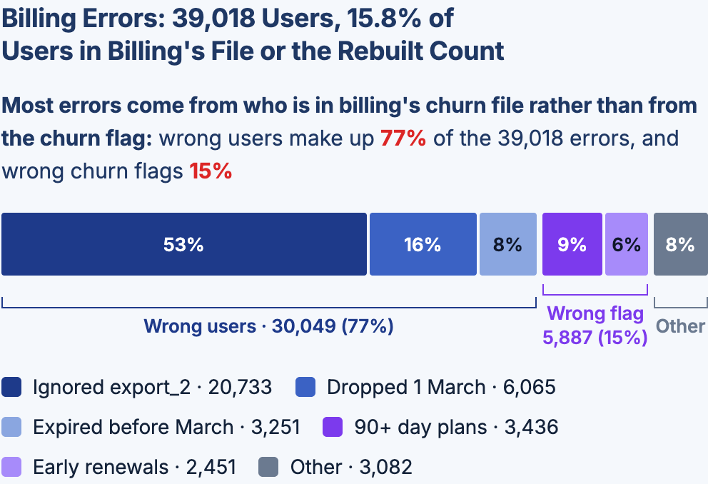

# Part 1c: Churn definition, validated against `churn_labels`

Interactive version with charts: https://miushkaenavimia.github.io/tune-analysis-submission/#churn

Built by `sql/06_churn_validation.sql`, which `run_all.py` runs after the clean layer (it takes under a second). It produces three tables:
`churn_mar17` (one row per user in the rebuilt cohort or in the labels, with outcome and disagreement bucket), `churn_confusion` and `churn_disagreement`.
Every number below comes from those tables.

## Summary

- **On the users both sides cover and whose outcome can be seen, the rebuilt rule and the labels agree on 96.5%** (197,972 of 205,213).
- **The labels do not follow their own written definition in four systematic ways.** About 32,500 users get a different label, or are in a different cohort, because of these rules. Each one is a clear pattern, not noise:
  1. Renewing onto a **90+ day plan** in March is labelled churned (97.7% of such users).
  2. **Renewing early** is often labelled churned, although the definition says it counts as retained.
  3. The cohort looks as if it was **built from export_1 alone**, so users whose February renewal (in export_2) pushed expiry past March are still included.
  4. **Expiries on 1 March are left out** (4.8% labelled, against about 100% for 2–31 March).
- **For 10,740 users (4.8% of the rebuilt cohort) the data cannot give an answer.** They had not renewed by 31 March, and their 30-day window runs into April, which the data does not cover.
- **Under the written definition the labels' churn rate is impossible.** On the shared users the labels say 7.4% churned. Even if every unknown user churned, the definition caps it at 5.0%. The extra 2.4 points are users with a visible March renewal that the labels call churned.
- **Billing's labels are wrong for 39,018 users (15.8% of the 247,730 users in billing's file or the rebuilt count), for two reasons:** wrong users in `churn_labels.csv` (30,049, 77%: 20,733 whose February renewal in export_2 moved their expiry past March, 6,065 left out with a plan expiring on 01/03/17, 3,251 who expired before March) and a wrong churn flag (5,887, 15%: 3,436 moved to a 90+ day plan, 2,451 renewed a 30-day plan early). The other 3,082 (8%) are the smaller groups in section 3.
- **What this means for later parts.** Parts 2 and 3 use churn rebuilt from the transactions (`fct_user_month`), applied to every month. The labels are not used for training. Their bias against long plans would make annual plans look worse, which is exactly the question Q4 asks.

## 1. Implementation

The definition (BRIEF.md): the cohort is users whose membership was due to expire in March 2017, based on all transactions up to and including 28/02/17. A user has churned if there is no `is_cancel = 0` transaction between 01/03/17 and 30 days after expiry. Renewing early counts as retained. A cancellation can move the expiry earlier.

| Choice | Rebuilt rule | Why |
|---|---|---|
| Expiry as of Feb 28 | Expiry after the user's **last** event (by `event_seq`) dated on or before 28/02/17 | It is a state "based on all transactions up to Feb 28". I take the last event, not the maximum, because a cancel can move expiry earlier |
| Which export version | `expires_at_asof_feb`: the export_1 value where the two exports carry conflicting versions of one event (T4) | That is the version that existed as of February |
| Cohort | That expiry falls between 01/03/17 and 31/03/17 | Wording of the definition |
| Cancel in March | If a cancel comes before any renewal and moves the expiry earlier, the window starts from the new expiry (1,534 users) | "A cancellation can move a user's expiry date earlier" |
| What counts as a renewal | Any `is_cancel = 0` event, paid or free, any plan length | The definition's own words. Only 316 renewals are free-only |
| Window | From 01/03/17 to effective expiry + 30 days. Early renewals in March are therefore inside it | Wording of the definition |
| Outcome | **retained**: a renewal inside the window. **churned**: no renewal, and the window closed by 31/03/17. **unknown**: no renewal yet, and the window runs past 31/03/17 | The data ends on 31/03/17. April is not guessed |

Only one expiry date has a window that closes inside the data: 1 March (1 March + 30 days = 31 March). So "churned" can only be observed for 1-March expiries and for a few users whose cancel pulled expiry earlier. Everyone else who has not renewed is **unknown**.

Consistency check: the 364 churned users of the rebuilt rule equal the Mar 2017 churn that the clean layer reports independently (`fct_user_month`, is_churned = 1 in March 2017, using the same 30-day rule).

## 2. Agreement

### Who is in the cohort

| | Users |
|---|---:|
| Labelled by billing | 241,665 |
| In the rebuilt cohort | 222,018 |
| In both | 215,953 |
| Labelled only | 25,712 |
| Ours only | 6,065 |

87% of the union is in both.

### Confusion matrix (rebuilt outcome × billing label)

| Rebuilt outcome | Label: retained | Label: churned | No label | Total |
|---|---:|---:|---:|---:|
| retained | **197,877** | 7,239 | 5,798 | 210,914 |
| churned | 2 | **95** | 267 | 364 |
| unknown (window runs into April) | 2,141 | 8,599 | 0 | 10,740 |
| not in the rebuilt cohort | 19,998 | 5,714 | n/a | 25,712 |

Users in both, with an outcome that can be observed (205,213):

| | Label: retained | Label: churned |
|---|---:|---:|
| **Ours: retained** | 197,877 | 7,239 |
| **Ours: churned** | 2 | 95 |

- Agreement: **96.5%**.
- When the rebuilt rule says churned, the label agrees in 95 of 97 cases.
- When the rebuilt rule says retained, the label agrees 96.5% of the time.
- Cohen's kappa is low (about 0.02). The reason is the data, not the rule: churn can be observed for only 97 users, so almost every possible label "churned" falls into the retained row. The buckets below explain all 7,239.

### Churn rate on the shared users (215,953)

| | Churn rate |
|---|---:|
| Ours, observed churn only (lower bound) | 0.04% |
| Ours, if every "unknown" user churned (upper bound) | 5.0% |
| Billing labels | **7.4%** |

The labels are above the highest value the written definition allows. That alone shows that the labels count some visible renewals as churn.

## 3. Where and why the rebuilt rule and the labels disagree

Each user falls into exactly one bucket (`churn_mar17.bucket`). The label churn % is the share of the bucket that billing labelled churned.

| Bucket | Users | Label churn % | What happened | Confidence in the explanation |
|---|---:|---:|---|---|
| A1 match: retained | 197,877 | 0% | | |
| A2 match: churned | 95 | 100% | | |
| **B1 not yet known** | 10,740 | 80.1% | No renewal by 31 March. Billing had April data, the files don't. This is not a disagreement, but it cannot be checked | n/a |
| **C1 renewed onto a 90+ day plan** | 3,436 | 100% | Bought a 90, 180, 195, 360 or 410-day plan in March. Of all 3,516 such users, 97.7% are labelled churned. That holds whether the previous plan was long (99.9%) or 30 days (92.0%). The definition counts any non-cancel transaction | High that it is a rule in billing's code. Why, unknown |
| **C2 renewed, then cancelled in March** | 1,352 | 100% | Billing seems to treat a later cancel as undoing the renewal (84.9% of the 1,593 such users are labelled churned). The definition is ambiguous here, and I follow its literal wording | Medium. A defensible alternative reading |
| **C3 renewed on a 30-day plan, labelled churned** | 2,451 | 100% | 2,280 of them (93%) **renewed early**. Among early Manual renewers, 49.5% are labelled churned, against 0.3% for on-time or late Manual renewers. Auto-renew: 5.0% against 0.1%. This fits billing not counting purchases made before the old expiry, which contradicts "renewing early counts as retained". The other 171 are unexplained (possibly April refunds or cancels the files don't show) | Medium-high for the early-renewal pattern |
| C4 no renewal, window closed, labelled retained | 2 | 0% | Unexplained | Negligible |
| **D2 labelled, but a February renewal already pushed expiry past March** | 20,733 | 15.4% | Renewed in February, so as of 28 February they are no longer due in March. Their February renewal sits in export_2, and export_1 holds no expiry after 31 March. Seen through export_1 alone, their expiry is still in March. Every user whose export_1-only expiry falls between 2 and 31 March has a label (0 missing). So billing's cohort looks as if it was built from export_1 alone | High |
| D3 labelled, a cancel by Feb 28 moved expiry into February | 1,017 | 96.1% | Billing used the expiry from before the cancel. The definition says a cancel can move expiry earlier, so they are not due in March | High |
| D4 labelled, expired before March | 3,251 | 34.4% | Not due in March in any version of the data | Unexplained |
| D1 labelled, no transaction up to Feb 28 | 639 | 54.3% | Their first transaction is in March | Unexplained |
| D5 labelled, expiry after March (other) | 72 | 100% | | Unexplained |
| **E1 in the rebuilt cohort, not labelled: expiry on 1 March** | 6,065 | n/a | Only 307 of the 6,372 users expiring on 1 March have a label (4.8%), against about 100% for every day from 2 to 31 March. Billing seems to treat expiry as an exclusive end date (1 March expiry = last access on 28 February), or used a "> 1 March" filter | High that it is a boundary rule. Which one, unknown |

**Explained by a clear pattern:** C1, C2, C3 (early renewals), D2, D3 and E1 cover about 34,900 users. They are differences in rules, not random errors. In nearly every case the labels drift away from the written definition.

**Unexplained:** C3 non-early, C4, D1, D4 and D5 cover about 4,100 users (1.7% of the union).



## 4. What cannot be determined from this data

1. **What happened in April.** 10,740 users (4.8% of the rebuilt cohort) had not renewed by 31 March, and their window runs to the end of April. The labels say 80% of them churned. The data can neither confirm nor contradict that.
2. **Whether April events changed March renewals.** A refund or cancel in April could reverse a March renewal. That could explain part of C2 and C3, and the files do not show it.
3. **Billing's actual code and inputs.** Which file it read, which cutoff it used, whether expiry is inclusive, and how it treats long plans and early renewals. My explanations are patterns in the data that fit these rules. Only billing's query can confirm them.
4. **The intended rule for "renewed, then cancelled".** The definition does not say whether a cancel after a renewal undoes it (C2, 1,352 users).
5. **What `expires_at` means exactly.** The files do not say. I assume it is the **last day of access**, the same way in every table: a 1-March expiry still gives access on 1 March, so those users belong in the March cohort (E1, 6,065 users), count as active in March 2017, and a renewal on the day after expiry is on time.
6. **Why D1 and D4 users are labelled at all** (3,890 users). No record in the files puts them in the March cohort.

## 5. Decisions for the rest of the analysis

- **Churn in Part 2 and Part 3 is rebuilt from the transactions**, applied to every month, independent of the labels. Part 1c keeps billing's 30-day rule because the brief defines it here. Parts 2 and 3 use the main rule: not charged again within 3 days (Auto-renew) or no purchase within 30 days (Manual), because 98.5% of Auto-renew users who return are back by day 3, while Manual users reach 94–96% only by day 30 (`reports/04_metrics.md`). 30 days for everyone stays as a side check.
- **The labels are not used as a training target.** Their errors are not random. C1 marks almost every buyer of a long plan as churned, which would bias "should we push annual plans" (Q4) against annual plans. C3 penalises early renewers, who are among the most engaged users.
- **Questions for billing:** the five open points in section 4, above all the C1 rule and the 1-March boundary.

## Reproduce

```bash
python run_all.py                 # rebuilds everything, including sql/06_churn_validation.sql
python query.py                   # then, for example:
#   SELECT * FROM churn_confusion;
#   SELECT * FROM churn_disagreement;
#   SELECT * FROM churn_mar17 WHERE bucket LIKE 'C1%' LIMIT 20;
```
