# Part 2 · Core metrics (monthly, Jan 2015 – Mar 2017)

Interactive version with charts: https://miushkaenavimia.github.io/tune-analysis-submission/#p2-active

Built by `sql/08_metrics.sql` and `sql/10_churn_by_type.sql` from `fct_user_month` and `fct_subscription` (Part 1b).
Output tables: `mart_metrics_month` (one row per month), `mart_churn_by_type` (month × subscriber type × churn rule) and `mart_churn_windows` (month × a 30 / 32 / 45-day window for everyone, side checks).
Churn is rebuilt from the transactions, not taken from billing's `churn_labels.csv`.

**Churn rule (the same on every tab):** a paying subscriber has churned when they are not charged again within **3 days** (Auto-renew) or make no purchase within **30 days** (Manual). "30 days for everyone", the rule billing uses in 1c, is kept only as a side check.

**Date assumption (applied the same way everywhere):** `expires_at` is the **last day of access**. A plan with `expires_at` 01/03/17 gives access on 1 March, so the user counts as active in Mar 2017 (`covered_end` = expiry + 1 day in `fct_subscription`), and a purchase on the day after expiry is an on-time renewal with no day without access.

## Definitions

| Metric | Precise definition |
|---|---|
| **Paying subscriber** (active subscriber) | User with at least 1 day of **paid** access in the month (`fct_user_month.is_active_paid = 1`). Free-trial and unpriced free days don't count. A cancellation ends access, and a user with overlapping plans counts once |
| All active | At least 1 day of any access in the month, paid or free trial (`is_active = 1`) |
| Share paying | Paying subscribers ÷ all active users, same month |
| Monthly growth | Paying subscribers this month ÷ paying subscribers last month, minus 1. Yearly average = plain average of that year's months (Jan 2015 has no earlier month) |
| **New** | Paying subscriber whose first purchase in the data is in this month (`is_new = 1`) |
| **Reactivated** | Paying subscriber who bought again more than 30 days after the last plan ended (a new `episode_id`, `is_reactivated = 1`). A user who is also New counts as New |
| **Renewing** | Every other paying subscriber: bought again within 30 days of the last plan's end (early renewals included), or still inside an earlier plan. New + Reactivated + Renewing = paying subscribers (checked) |
| **Paid churn** | A membership episode with at least 1 paid period ends this month (expiry date in the month) and the user is not charged again within 3 days (Auto-renew) or makes no purchase within 30 days (Manual). Episodes that were only free trials are counted apart (`free_only_churned`), not as churn |
| Not yet known | The episode ends this month but its churn window runs past 31/03/17: the outcome is unknown and left out. An Auto-renew plan due by 28/03/17 can be judged, a Manual plan only up to 01/03/17 |
| **Monthly churn rate** | Paid churn this month ÷ paying subscribers on the first day of the month |
| Cash revenue | `amount_paid` of purchases made in the month |
| **Revenue (recognised)** | Each paid purchase spread evenly over its plan days; a month gets the days that fall in it (an annual plan counts about 1/12 a month instead of all up front) |
| **ARPU** | Recognised revenue ÷ all active subscribers (paying + free trial) |
| **ARPPU** | Recognised revenue ÷ paying subscribers (the `arpu` column of `mart_metrics_month`) |
| **Discount depth** | Over **paid** purchases made in the month: `sum(discount_amount) ÷ sum(list_price)`, plus the % of paid purchases with any discount. Free trials (100% off) are counted as free-trial starts, not inside depth |

## Results

| | 2015 (Feb–Dec) | 2016 | 2017 (Jan–Mar) |
|---|---:|---:|---:|
| Paying subscribers (monthly average) | 191,011 | 266,234 | 301,879 |
| New, % of paying subscribers | 6.9% | 3.9% | 2.8% |
| Reactivated, % of paying subscribers | 1.9% | 2.3% | 1.6% |
| ARPU (average, without free-trial-wave months) | $129 | $118 | $123 |
| ARPPU (average, without free-trial-wave months) | $134 | $122 | $124 |

Monthly churn is given below for the two 12-month windows the site uses. ARPU and ARPPU averages leave out the free-trial-wave months Jun 2015 and Nov 2016.

- **Active subscribers (2.1):**
  - *Mar 2017 snapshot:* 303,374 paying subscribers, +18.3% vs Mar 2016. All active 306,054, so 99.1% of active users paid (95.7% in Mar 2016).
  - *Are subscribers paying? Yes.* 92%–99% of active users pay in normal months. Free-trial waves pulled the share down for one month each: 81% in Jun 2015 (41,854 trial users, 12.9% later paid) and 86% in Nov 2016 (47,866, 4.8% paid by Mar 2017).
  - *Is growth slowing? Yes.* Average monthly growth of paying subscribers: 5.6% (2015), 2.0% (2016), 0.8% (Jan 2017 – Mar 2017). Year on year: +53.5% (Mar 2015 → Mar 2016), +18.3% (Mar 2016 → Mar 2017).
  - *Apr 2016 – Jun 2016 dip:* paying users on payment method 39 fell from 19,408 (Mar 2016) to 3,185 (Apr 2016) and 1,874 (Jun 2016), back to 18,923 in Jul 2016: a billing pause at one provider, not users leaving. Paying subscribers fell −6.3% in Apr 2016 (256,486 → 240,338) and rose +11.3% in Jul 2016 (244,341 → 272,067).
  - *Why 303,374 and not 306,957:* the higher number counts raw transaction rows (transaction date to expiry, non-cancel rows). Here the count runs on the clean data, where a cancellation ends access and overlapping plans count once.
- **New vs Renewing vs Reactivated (2.2):** in Mar 2017, 96.1% of paying subscribers are Renewing subscribers (291,502), 2.8% New subscribers (8,381) and 1.2% Reactivated subscribers (3,491). By quarter, Renewing rose from 92.4% (Q1 2016) to 95.5% (Q1 2017), while New's share halved from 5.7% to 2.8%. New fell in both share and count: 8,381 in Mar 2017, −28% vs Mar 2016; 122,827 in 2016 (about 10,200 a month) against about 8,600 a month in Q1 2017. Since Sep 2016, fewer New subscribers join each month than paying subscribers leave (8,872 vs 13,870 in Feb 2017). Reactivated subscribers stay at about 1%–3% of paying subscribers, except the two billing-gap returns (Jun 2015, Jul 2016). 2015's 6.9% New share is overstated by the data start (see below).
- **Monthly churn (2.3):** the average monthly churn rate is **4.3% in Mar 2016 – Feb 2017**, down from **4.9% in Feb 2015 – Feb 2016** (−13%), both without the two billing-gap months (Apr 2015, Mar 2016) and the Jan 2016 late charge. Since Apr 2016 monthly churn has stayed between 3.3% and 5.1%, against billing-gap spikes of up to 14.2%. With 30 days for everyone (side check) the same two averages are 3.9% and 4.4%.
- **ARPU (2.4):** ARPU fell −9% from $129 a month in 2015 to $118 in 2016, and rose +5% to $123 in Q1 2017, still below 2015. Outside the two free-trial months ARPU and ARPPU almost overlap, as 92%–99% of active subscribers pay; in Jun 2015 and Nov 2016 ARPU fell to $97 and $105. Revenue grew because more people pay: Q1 2017 against Q1 2016, revenue grew +24% from $90.4M to $112.3M, mostly because paying subscribers grew +19% (254k to 302k a month), while ARPPU grew only +4% from $119 to $124. Monthly recognised revenue grew from $27.0M (Aug 2015) to $40.4M (Mar 2017).
- **Discounts (2.4):** discounts fell from 9.7% of paid purchases in Jan 2015 to 0.01% in Nov 2015, with a discount depth of at most 1.6%, so they do not explain the revenue growth from Q1 2016 to Q1 2017. A cheaper plan took their place: Auto-renew monthly purchases at $99, against the usual $149, grew from 0% before Jul 2015 to 42.8% in Mar 2017. Per subscriber, discounts did not lower revenue: Auto-renew monthly subscribers at $149 (payment method 41) who paid with a discount in Jan 2015 – Oct 2015 paid $1,700 each over the next 12 months, against $1,540 at full price (+10%), and every start month points the same way. 80%–87% of them were still paying a year later, against 71%–78% at full price. The data does not show why they got a discount, so this is not a random test. Promotion moved to free trials: 42,743 free-trial starts in Jun 2015 and 58,821 in Oct 2016 – Nov 2016.

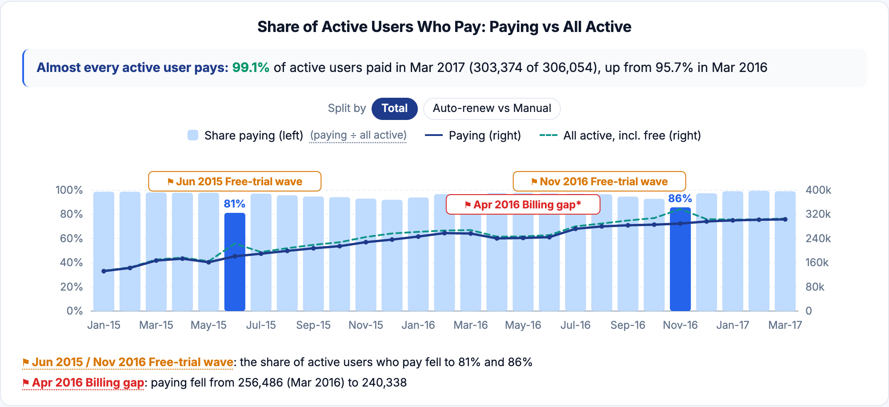

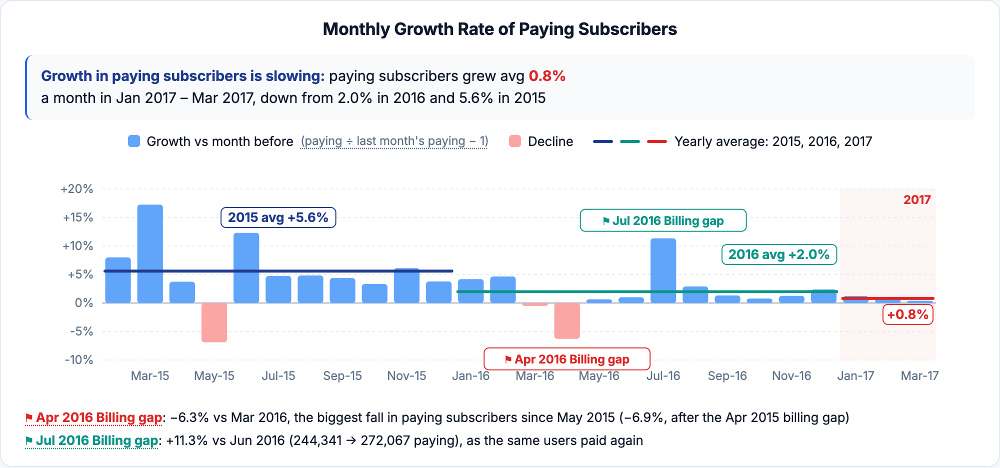

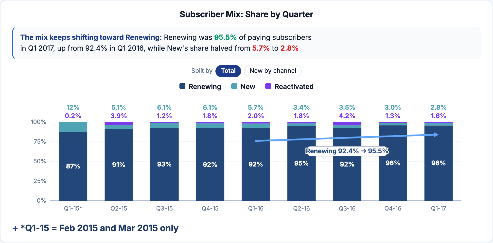

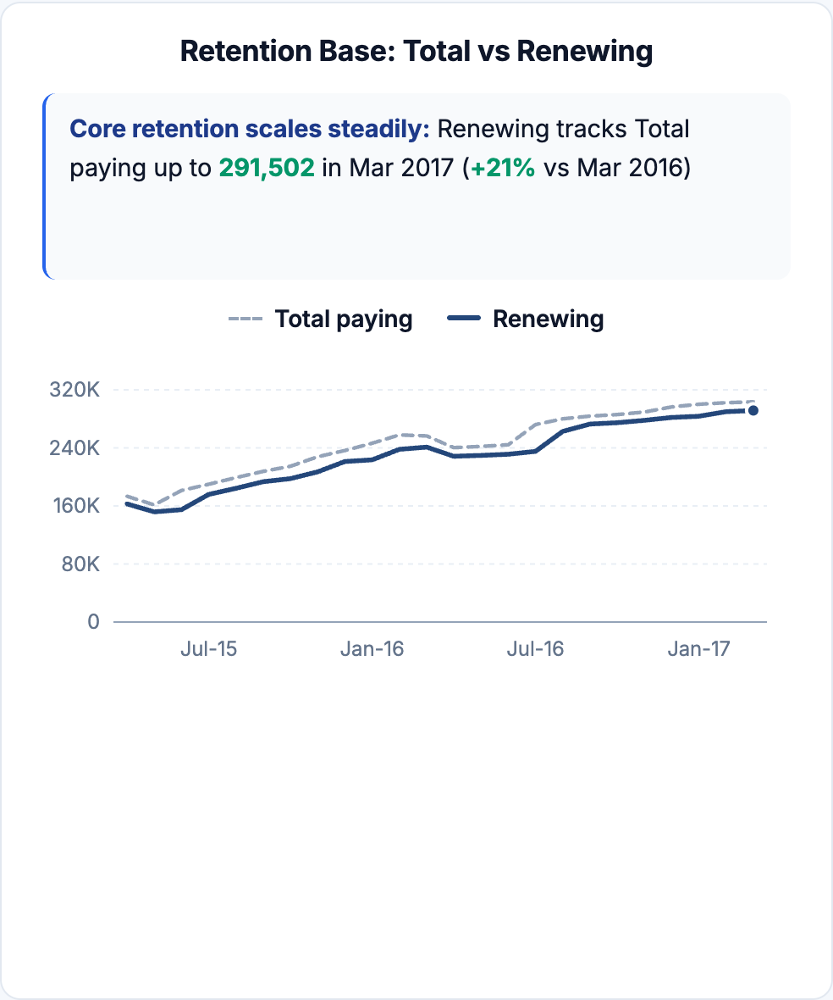

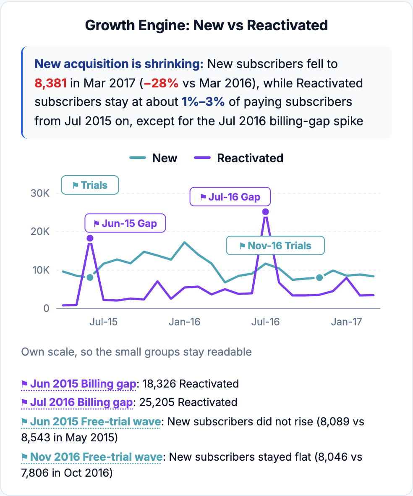

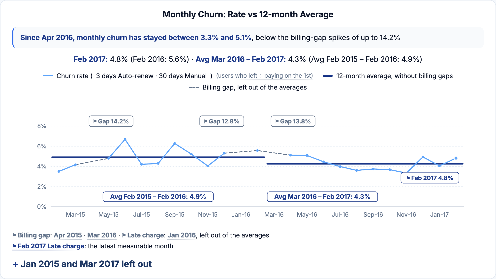

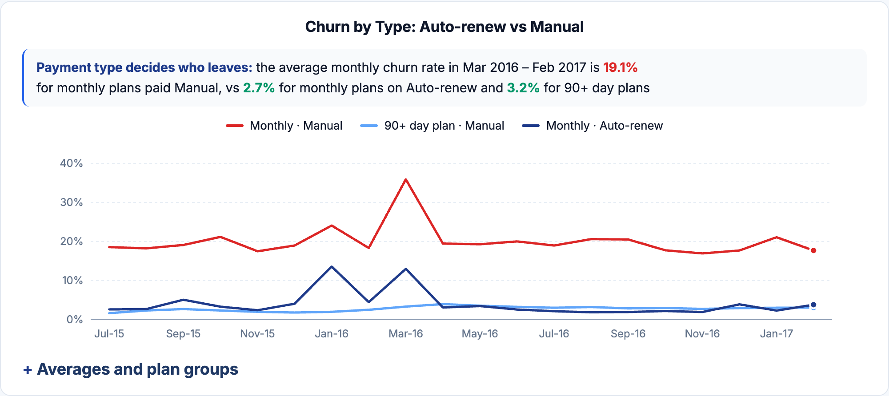

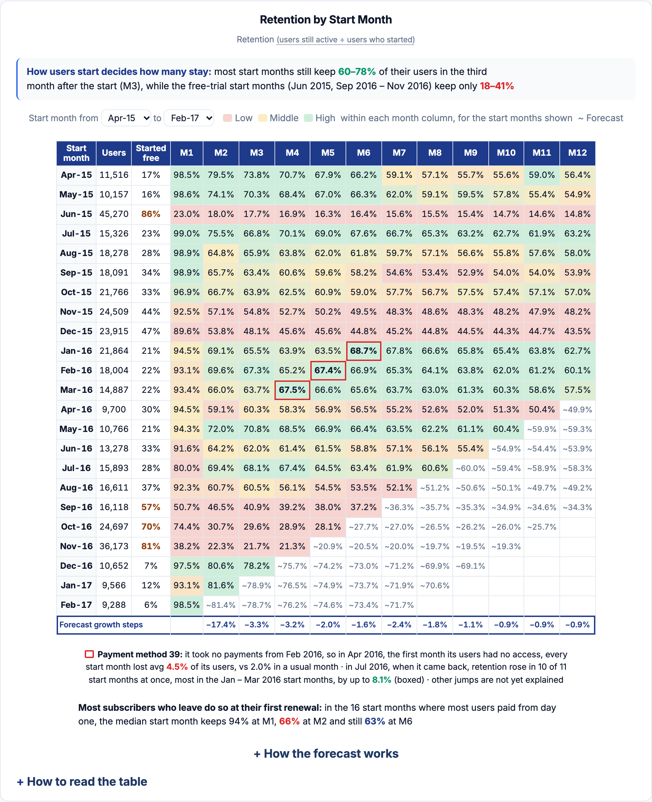

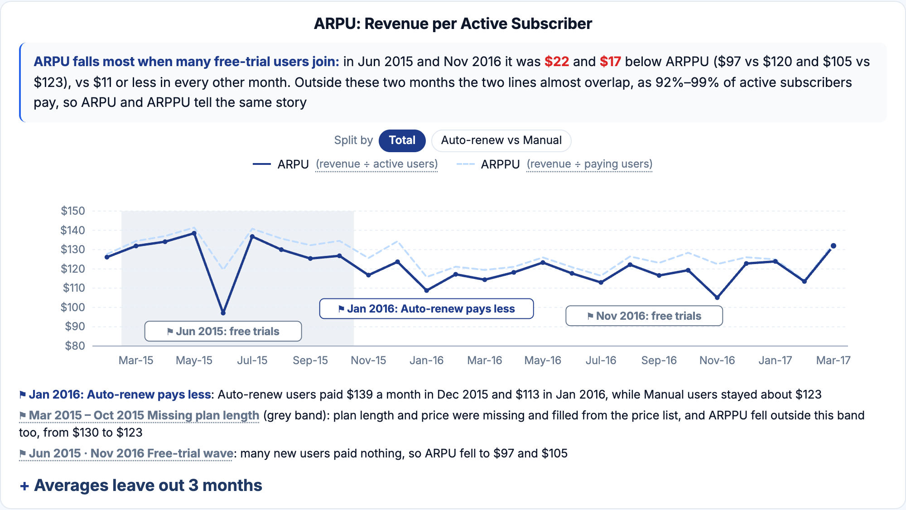

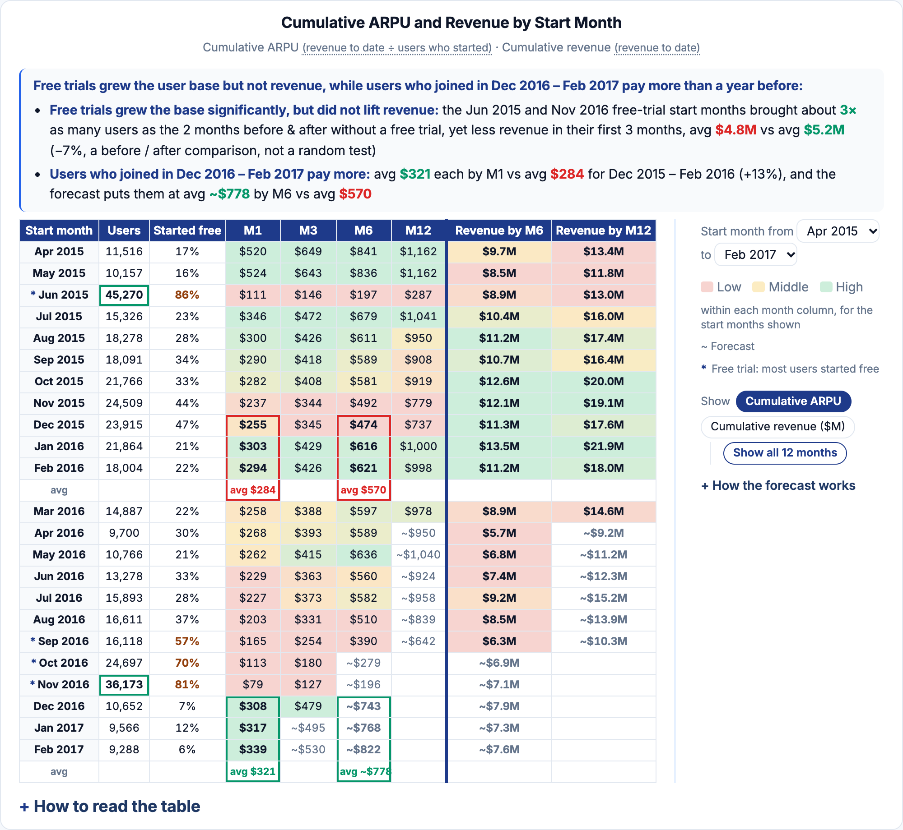

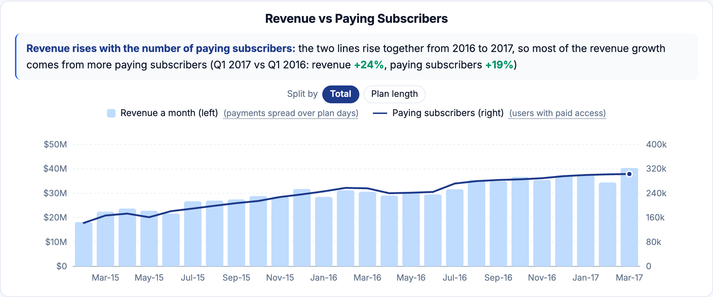

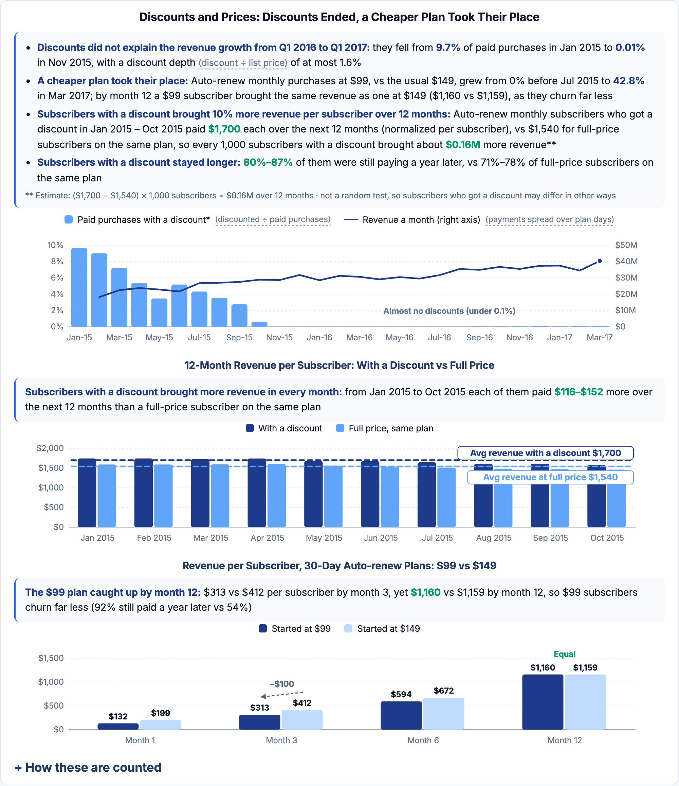

## What I don't trust, and why (2.5)

Five points I don't trust, each marked on the charts:

| Period | Problem | Evidence | What I did |
|---|---|---|---|
| Jan 2015 – Mar 2015 · Data start | The files begin on 01/01/15, so customers who paid in 2014 count as New subscribers. Jan 2015 is 100% New and has only 5,179 subscribers at the start of the month | New subscribers are 16.3% of paying subscribers in Mar 2015 against 5.6% in Apr 2015; in Mar 2015, 17,998 customers from 2014 were first charged on one day | Trends start in Feb 2015; Jan 2015 churn can't be measured; read the drop in New from 2016 on |
| Mar 2015 – Oct 2015 · Missing plan length | 214,207 paid purchases (17% of paid purchases) have no plan length or price | 1a issue #2 | Filled from the price list; 2015 revenue and ARPU rest on that fill (grey band) |
| Apr 2015 → Jun 2015 · Billing gap | Payment methods 31, 33, 34 did not charge 16,295 Auto-renew users | Churn jumps to 14.2% in Apr 2015; 99.8% of them return as Reactivated in Jun 2015 (the 10.1% spike); $4.9M not collected | Left out of churn averages |
| Apr 2015 – Feb 2016 · Annual renewals | Customers who bought an annual plan in 2014 first appear at renewal, so they count as New | About 1,000 extra New a month (about 1,300 on annual plans, against about 320 from Apr 2016) | Flagged |
| Mar 2016 – Jul 2016 · Billing gap | Payment method 39 did not charge 16,468 Auto-renew users (normal month: about 670) | Churn jumps to 13.8% in Mar 2016 (7.4% without them); 97% return as Reactivated in Jul 2016 (the 9.3% spike); $11.3M not collected | Left out of churn averages; likely involuntary, ask billing |

Other events marked on the charts:

| Period | What happened | Impact |
|---|---|---|
| Jun 2015 · Nov 2016 · Free-trial wave | 41,854 and 47,866 users were on a free trial that month; only 12.9% and 4.8% of them paid later | Share paying fell to 81% and 86%; ARPU fell to $97 and $105; New subscribers did not rise |
| Jan 2016 | Payment method 39 charged 15,970 Auto-renew users on the last day of the month, after the 3-day window | Churn 12.8% (4.9% with 30 days for everyone); left out of averages as a billing-gap month |
| Feb 2017 | The latest measurable month: 3,511 payment method 41 users were charged late, in mid Mar 2017, and the month has only 28 days | Churn a little high (4.8%); ARPPU $114 vs $133 in Mar 2017, a calendar effect, not a price cut |
| Mar 2017 | Data ends on 31/03/17: Manual needs 30 days after the plan ends to judge churn | Churn 1.7% against a 4.3% average; 10,169 paying subscribers not yet known (2,299 Auto-renew due 29/03/17 – 31/03/17, 7,870 Manual due 02/03/17 – 31/03/17, `mart_churn_by_type.paid_censored`). Left out of churn charts and averages. With 30 days for everyone, 14,178 are not yet known |
| Dec 2015, Dec 2016 (side check) | With 30 days for everyone, many December expiries renew on day 31–32 | 30-day churn 5.1% / 4.6% drops to 3.7% / 3.2% with 32 days (`mart_churn_windows`) |

Two smaller checks: "All active" includes free-trial waves (up to about 48,000 extra users), so the headline uses paying subscribers; 30-day churn in `mart_churn_windows` differs from `fct_user_month` by under 1% (5% in Dec 2015), because episodes are rebuilt there with a running membership end (validation query in `08_metrics.sql`).

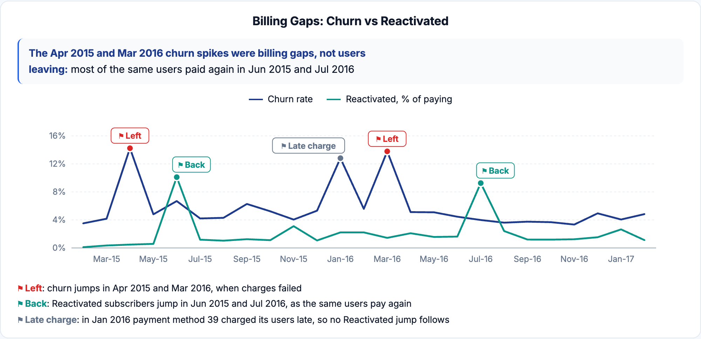

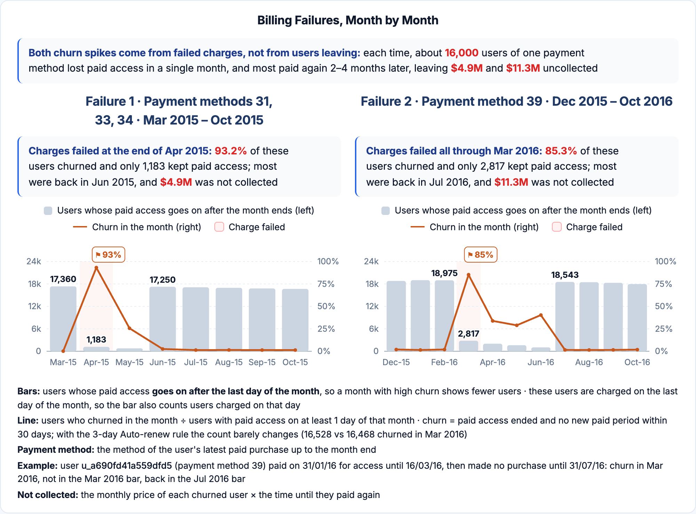

## Churn by subscriber type and the 3 / 30-day window (2.3)

Built by `sql/10_churn_by_type.sql`: `mart_churn_by_type` (month × type × rule; the 30-day totals equal `mart_churn_windows` at 30 days in every month), `mart_churn_mixed_window`, `mart_return_curve`.

- **Payment type decides who leaves:** average monthly churn rate in Mar 2016 – Feb 2017 (without the Mar 2016 billing gap) is 19.1% for monthly plans paid Manual, 2.7% for monthly plans on Auto-renew and 3.2% for 90+ day plans (quarterly, half-year, annual; none Auto-renew). With 30 days for everyone, Auto-renew would be 2.1%. Auto-renew is 76% of paying subscribers (Feb 2017), so both monthly groups lose about 4,000–4,500 a month. 30-day plans are 86–100% of the users who leave each month.
- **Why 3 / 30 days:** 98.5% of Auto-renew subscribers who return are back by day 3, while Manual subscribers reach 94–96% only by day 30 (returners = bought again within 60 days, plans ending Jan 2015 – Jan 2017; window = the day after which one more day brings back under about 0.5% of returners).

| Subscriber type | Day 1 | Day 3 | Day 7 | Day 14 | Day 30 | Day 45 | Window |
|---|---:|---:|---:|---:|---:|---:|---|
| Monthly · Auto-renew | 98.0% | 98.5% | 98.8% | 99.0% | 99.5% | 99.9% | 3 days |
| Monthly · Manual | 47.8% | 67.9% | 81.0% | 88.6% | 95.1% | 98.2% | 30 days |
| Quarterly · Manual | 58.3% | 72.2% | 81.3% | 88.0% | 94.4% | 97.8% | 30 days |
| Half-year · Manual | 53.2% | 69.9% | 81.1% | 88.3% | 95.0% | 98.1% | 30 days |
| Annual · Manual | 60.1% | 74.6% | 84.2% | 90.5% | 95.8% | 98.3% | 30 days |

- **Where the 3-day rule counts a late batch as churn:** when a provider charges a whole batch late on one day, the 3-day Auto-renew window counts it as churn: methods 37–40 on 01/07/15 (Jun 2015: 6.7% against 4.5% with 30 days for everyone), method 39 on the last day of Jan 2016 (12.8% against 4.9%, left out of the averages) and method 41 in mid Mar 2017 (Feb 2017: 4.8%).
