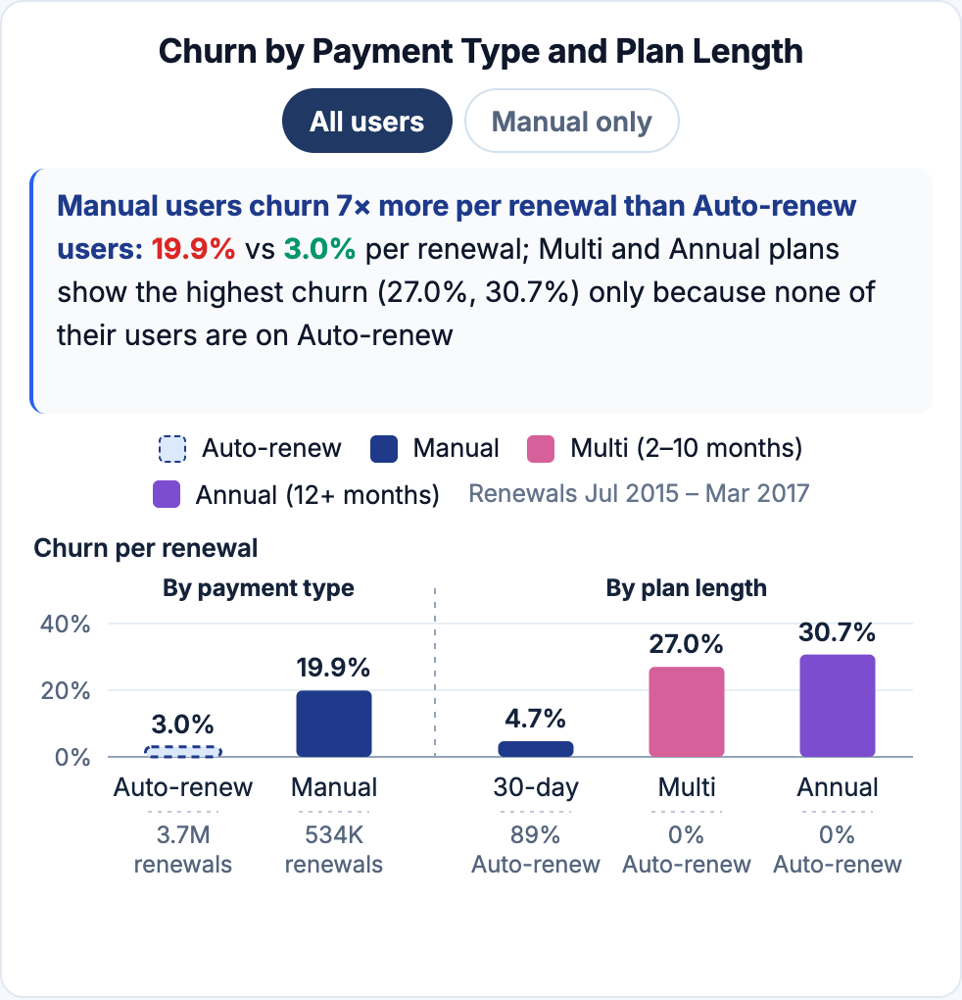
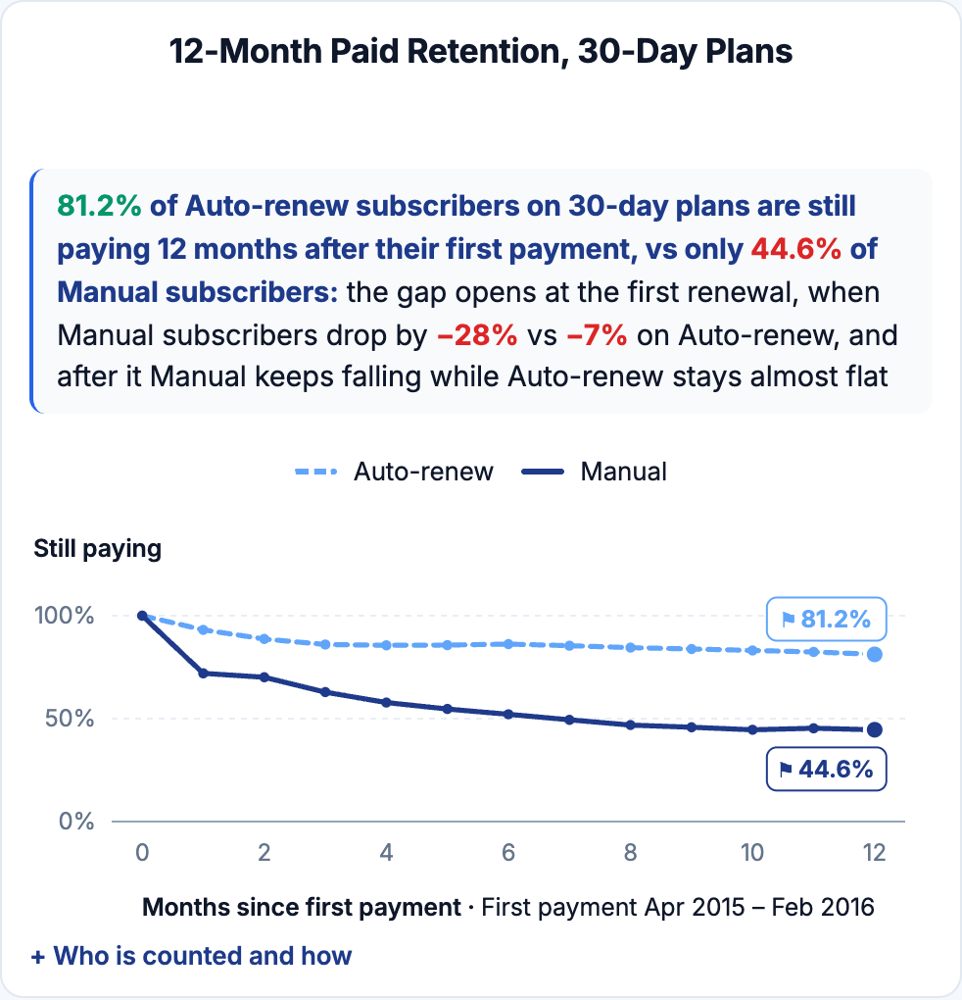
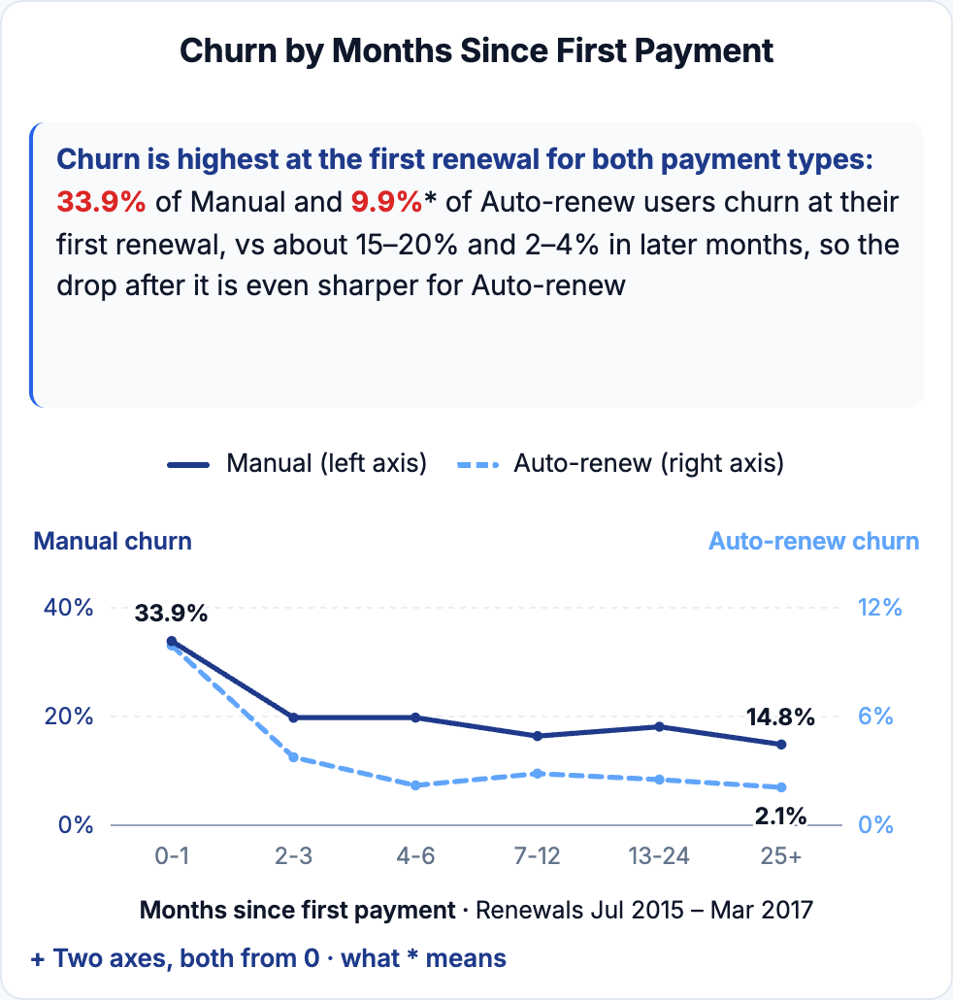
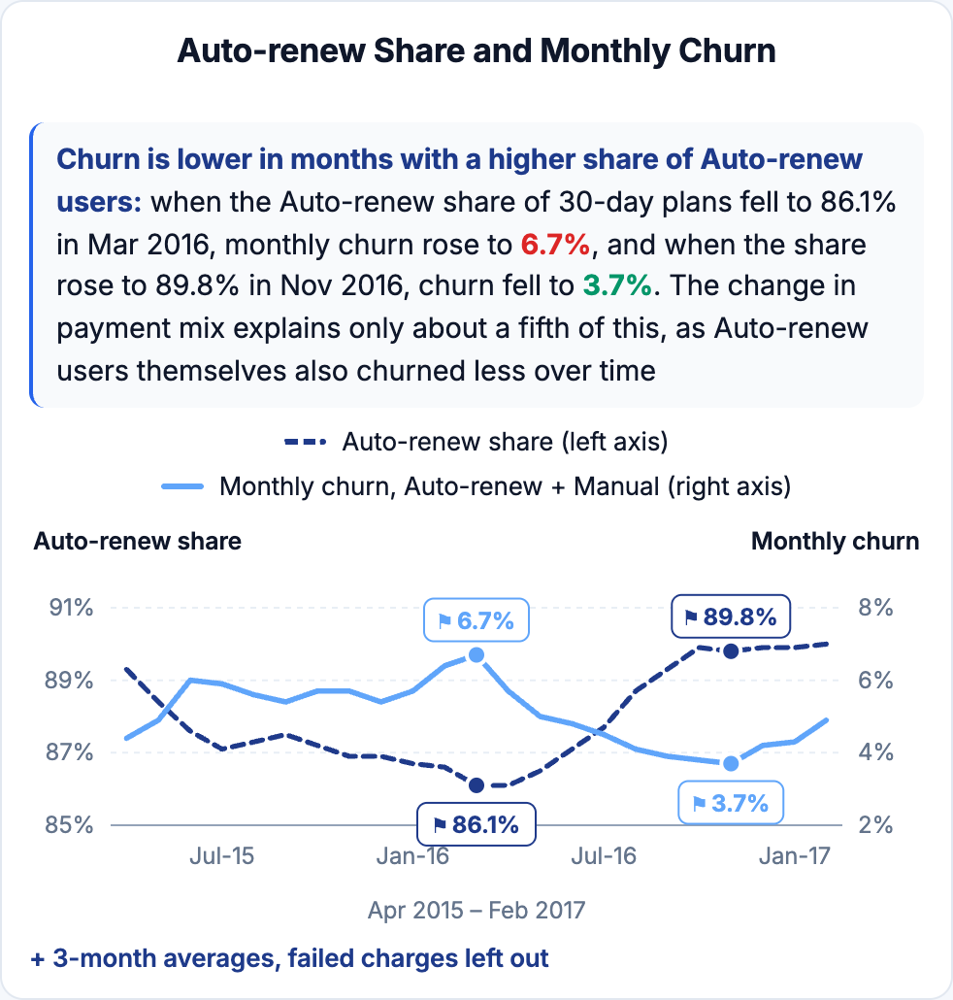
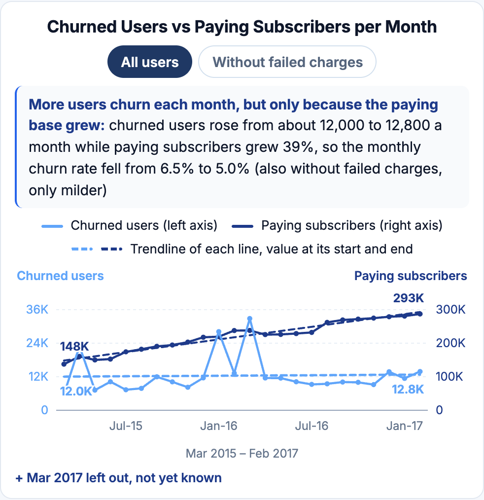
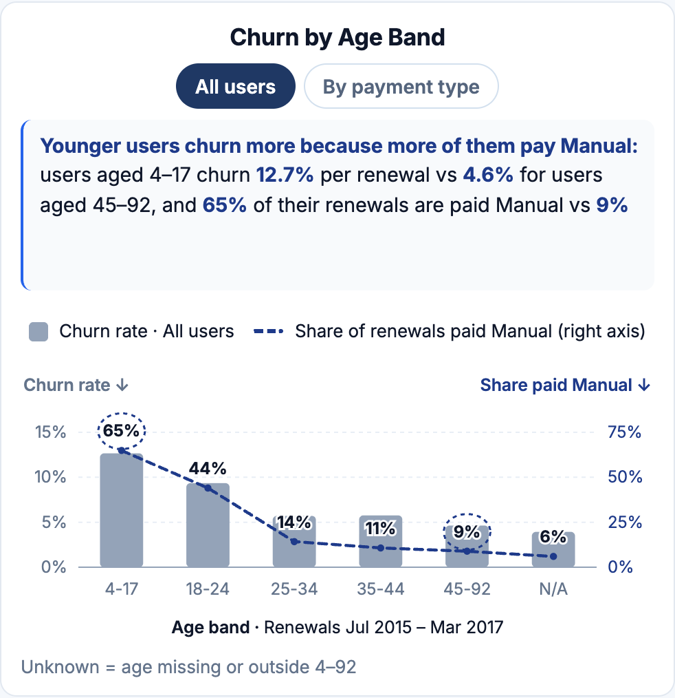
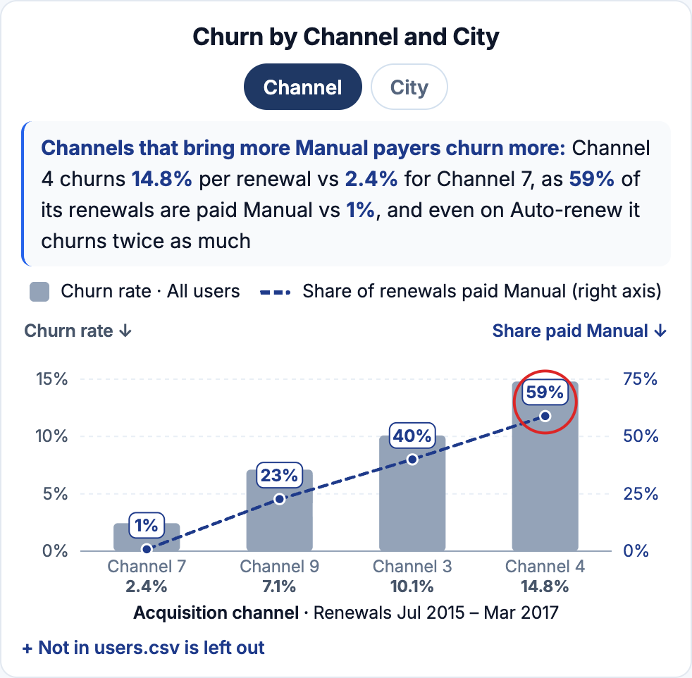
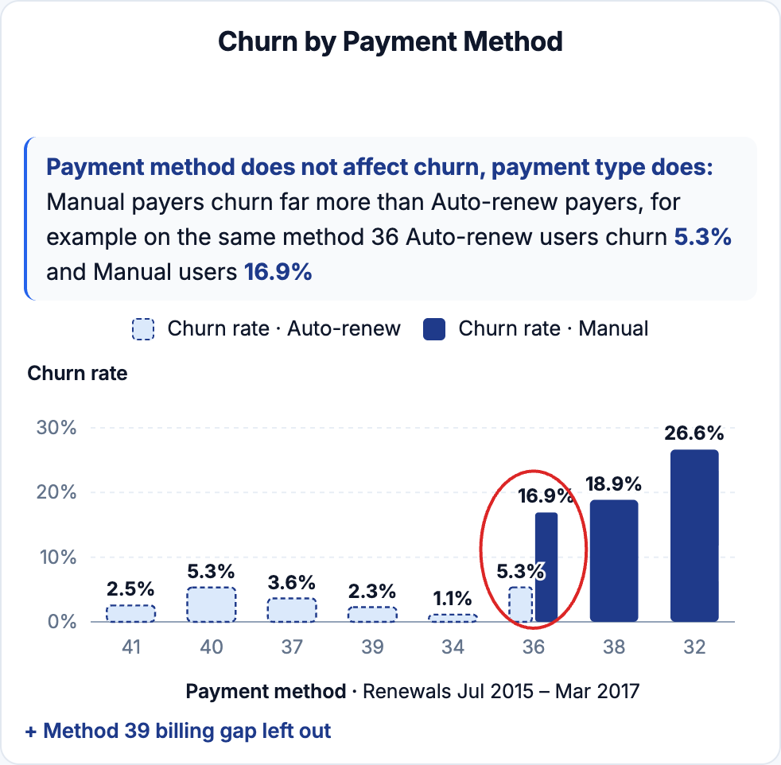
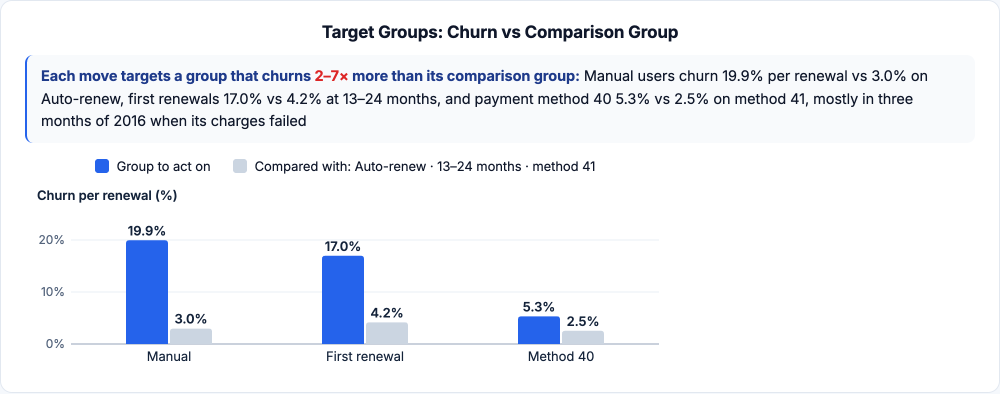

# Part 3 · Deep dive (a): what drives churn

Interactive version with charts: https://miushkaenavimia.github.io/tune-analysis-submission/#p3a

**Bottom line.**
- **Payment type is the strongest driver of churn:** Manual users churn 19.9% per renewal against 3.0% for Auto-renew users.
- **Churn is highest at the first renewal:** 17.0% against 4.5% at later renewals; even among Auto-renew users, 9.9% against 2.7%.
- **Age, city and plan length only appear to drive churn:** young users, some cities and long plans use Auto-renew far less, so their higher churn reflects how they pay. Among Auto-renew users every age band churns 2.8–3.8%, and Multi and Annual plans are all paid Manual, while 89% of 30-day renewals are on Auto-renew.
- **Acquisition channel keeps a smaller real effect:** among Auto-renew users, Channel 7 churns 2.3% against 3.3–4.9% for the other channels.

SQL: `sql/13_churn_rule_3_30.sql` (main rule) → `mart_renewal_decisions_3d`, `mart_churn_drivers_3d`, `mart_churn_factor_summary_3d`, `mart_churn_plan_monthly_3d`, `mart_churn_method_quarter_3d`. `sql/09_deep_dive.sql` builds the same tables without the suffix with 30 days for everyone (side check).
Site: Part 3 tabs (`#p3a`, `#p3a-act`).

## How it was measured

| | |
|---|---|
| Unit | One **paid renewal that came due**: a paid subscription period whose expiry falls in Jul 2015 – Mar 2017 (`mart_renewal_decisions_3d`, 4,226,868 rows) |
| Churned | Not charged again within **3 days** of expiry on monthly Auto-renew plans, or no new purchase (`is_cancel = 0`, paid or free) within **30 days** on Manual plans. Early renewal counts as staying. "Within 3 days" = next purchase by expiry + 3, since `expires_at` is the last day of access (see `02_data_model.md`) |
| Why from Jul 2015 | In Apr 2015 charges failed on payment methods 31, 33 and 34 and users came back only in Jun 2015, so earlier months would count failed charges as people who left. In Jul 2015 – Nov 2015 plan length is rebuilt from dates for 11% of renewals (1a issue #2) |
| Not yet known, left out | A renewal is kept only when its own churn window ends by 31/03/17: Auto-renew up to an expiry of 28/03/17, Manual up to 01/03/17. 58,877 paid renewals due in Mar 2017 are left out: 31,292 Auto-renew due 29/03/17 – 31/03/17 and 27,585 Manual due 02/03/17 – 31/03/17 |
| Left out as drivers | Free-trial periods (their end is a conversion, not a renewal) and cancellations (cancelling *is* churning) |
| Billing incident | Payment method 39, expiries before 01/07/16: 39,323 renewals. It lost about 16,000 users in Mar 2016, and 97% were back by Jul 2016 (Part 2). Kept in the table, left out of the ranking |
| Base after that | 4,187,545 renewals, **5.1%** churn |

**Same payment mix (confounding check).** Indirect standardisation on the two contract terms that set churn mechanically: Auto-renew (on / off) × plan length. For each group, `same payment mix = observed churn ÷ expected churn × 5.1%`, where expected uses each renewal's stratum rate. For Auto-renew itself plan length is held fixed, and for plan length Auto-renew is held fixed. "Gap" = highest ÷ lowest group, groups with at least 10,000 renewals.

## Which factors matter

| Factor | Gap as it looks | Gap, same payment mix | Verdict |
|---|---:|---:|---|
| Auto-renew | 6.7× | **3.9×** | Real. Manual 19.9%, Auto-renew 3.0% |
| Payment method | 23.6× | **4.7×** | Mostly Auto-renew. A gap between providers remains: method 40 5.3% vs method 41 2.5% (both 100% Auto-renew), mostly from failed charges in Jan 2016, Mar 2016 and May 2016; since Nov 2016 it is small (3.4% vs 2.7%) |
| Tenure | 6.8× | **3.1×** | Real. First renewal (a subscriber's first or second month) 17.0% (9.9% even on Auto-renew) vs 4.5% later |
| Acquisition channel | 6.1× | 1.8× | Mostly mix: Channel 7 is 99% Auto-renew, Channel 4 41%. Among Auto-renew users Channel 4 still churns about twice as much as Channel 7 (4.9% vs 2.3%) |
| City | 3.4× | 1.7× | Mostly mix; City 1 looks like a default value (empty profiles). City 9's Manual users churn 33% per renewal against 17%–22% in the other large cities |
| Plan length | 6.6× | 1.6× | Misleading per renewal (see below) |
| Age band | 3.2× | **1.3×** | Confounded: young users churn more only because fewer use Auto-renew (35–56% for ages 4–24 vs 86–91% for 25 and over) |

**Manual users account for most churn:** they make up 13% of renewals but 50% of all churned renewals.

**Plan length.** Every long plan is paid Manual. Among Manual users a 12-month plan loses 30.7% at renewal but renews once a year: **2.7% per month** of cover against **18.5%** on Manual 30-day plans (2–10 months: 27.0% per renewal, 5.4% per month). Committed users may be the ones who pick annual plans, so this is not proof that annual plans retain; that is the Part 5a test.

**Payment method 39 by quarter.** 1.7% (Q3 2015), 2.0% (Q4 2015), 91.3% (Q1 2016), 89.7% (Q2 2016), then 6.1%, 2.1% and 1.8%. Other Auto-renew methods 1.9–4.1%; Manual users 18.7–21.4% every quarter. One incident, not a trend.

## What I would act on

I would focus on payment type and the first renewal rather than on audience targeting. Three moves could keep up to **~10,000 subscribers a year**, about 3% of today's 303,000 paying subscribers, if each one performs as estimated. Each move targets a group that churns 2–7× more than its comparison group.

| Move | Who it targets | Kept a year |
|:--|:--|:--|
| 1 · **Move Manual users to Auto-renew**: Auto-renew on by default at checkout | Manual users: they still churn 3.9× more with the same plan mix | ~3,200 per 10% of them moved, assuming they then churn half as much as today, not as little as today's Auto-renew users |
| 2 · **Win the first renewal**: onboarding, a progress reminder before the first charge, a goal in week one | First renewals: 9.9% churn even on Auto-renew, against about 2.7% later | ~5,200 if first-renewal churn falls by a quarter |
| 3 · **Watch failed payments per provider, every day**: alert on a jump in failed charges | Method 40 users: churn jumped to about 10% in Jan 2016, Mar 2016 and May 2016 while method 41 stayed near 2%; since Nov 2016 the gap is small (3.4% vs 2.7%). The 2016 method 39 billing gap cut off 16,468 users for up to 4 months and left $11.3M uncollected | ~1,600 if method 40 churns like method 41, at the gap since Nov 2016 |

Kept a year = renewals due Jul 2015 – Feb 2017 (failed payments: Nov 2016 – Mar 2017, after method 40's failed charges stopped), billing-gap renewals left out, scaled to 12 months. Confidence and what would change my mind: `reports/08_executive_summary.md` (tab 4.2).

**What I would not act on:**
- Age targeting: young users churn more only because fewer of them use Auto-renew; with the same payment mix the gap is only 1.3×.
- City or channel targeting: with the same payment mix the gaps are only 1.7–1.8×, mostly from users with empty profiles (City 1, missing from `users.csv`).
- Discouraging long plans: they have higher churn per renewal but far lower churn per month (2.7% vs 18.5%); whether annual plans truly retain subscribers is tested in Part 5a.

## Limits

- Cause, not just pattern: this is observational data, so only a test can prove that turning on Auto-renew lowers churn. Auto-renew users may be more committed to begin with.
- Why people leave: without app usage data, a subscriber who lost interest cannot be told apart from one whose card failed.
- Age and gender are missing for about two thirds of users, and City 1 looks like a default value.
- Tenure counts from the first paid date seen in the data, so customers who paid before 2015 look newer than they are.
- Renewals not yet known are left out: 58,877 paid renewals due in Mar 2017 whose window ends after 31/03/17.
- Side check, 30 days for everyone (`mart_renewal_decisions`): the cut is 01/03/17 for everyone, so 4,042,615 renewals are kept and 243,130 left out; every conclusion is the same.
