# Part 4 · Executive summary

For the CEO and the Head of Growth: the four leadership questions, three recommendations, and what I can't answer yet. Every number comes from Part 1 (data), Part 2 (metrics, `reports/04_metrics.md`) and Part 3 (churn drivers, `reports/05_deep_dive.md`).

Definitions used throughout:
- **Paying subscriber** = a paid subscription, not a free trial, valid on at least 1 day of the month.
- **Churn** = not charged again within **3 days** (Auto-renew) or no purchase within **30 days** (Manual). This is rebuilt from the transactions, not taken from billing's `churn_labels.csv`.

Interactive version with charts: https://miushkaenavimia.github.io/tune-analysis-submission/#p4

## 4.1 · Healthy, but new subscribers decline; Auto-renew and annual plans can lift growth

- **The base is healthy but slowing:** revenue grew +24% (Q1 2017 vs Q1 2016), but New subscribers have been falling since Jan 2016, so growth relies on renewals, which is a risk if churn rises
- **Retention is currently the biggest lever for paying-subscriber growth, while winning New subscribers reduces the reliance on renewals:** 3 moves could keep ~10K more paying subscribers a year who would otherwise leave (around +3% in paying subscribers & monthly revenue) (4.2)
  - Move Manual users to Auto-renew: ~3,200
  - Win the first renewal: ~5,200
  - Catch failed payments early: ~1,600
- **Free trials brought about 3× more users, but no more revenue:** summing their first 3 months, Jun 2015 & Nov 2016 brought slightly less than the average of the 2 months before & after without a free trial (Q3)
- **The 20% discount looks positive:** 10% more revenue per subscriber, though not from a random test (Q3)
- **Annual plans look promising:** twice the revenue of monthly plans; the 5a test shows if the offer makes people stay and pay more
- **Not answered yet:** why New subscribers are falling, why subscribers churn, and whether free trials and annual plans cause their results or only attract committed subscribers (4.3)

| Metric | Value |
|:--|:--|
| Paying subscribers, Mar 2017 | 303,374 (+18% vs Mar 2016) |
| Monthly growth of paying subscribers, yearly average | 5.6% (2015) → 2.0% (2016) → 0.8% (Jan 2017 – Mar 2017) |
| Monthly churn rate, average | 4.3% (Mar 2016 – Feb 2017), down from 4.9% (Feb 2015 – Feb 2016) |
| Renewing subscribers, share of paying subscribers | 95.5% in Q1 2017 (92.4% in Q1 2016) |
| New subscribers, share of paying subscribers | 2.8% in Q1 2017 (5.7% in Q1 2016) |
| New subscribers, count | 8,381 in Mar 2017 (−28% vs Mar 2016) |
| Revenue, Q1 2017 vs Q1 2016 | $112.3M vs $90.4M (+24%) |
| ARPPU (revenue ÷ paying subscribers), Q1 2017 vs Q1 2016 | $124 vs $119 (+4%) |

The churn averages leave out Apr 2015 and Mar 2016 (Billing gap) and Jan 2016 (Late charge), where charges failed on the company side and churn rose to 12.8%–14.2%.

### Q1 · How healthy is the subscriber base, and how is it trending?

**The subscriber base is healthy, but its growth is slowing and now relies on renewals:**
- **New subscribers are falling:** from a peak of 17.3K in Jan 2016 to 8.4K in Mar 2017 (−28% vs. Mar 2016) & since Sep 2016 fewer join each month than paying subscribers leave (8.9K vs. 13.9K in Feb 2017), so 96.1% of paying subscribers are now Renewing subscribers (2.2)
- **Retention is strong on Auto-renew:** 81.2% of new Auto-renew subscribers still pay after 12 months, against 44.6% on Manual (3a; users whose first paid plan was a 30-day plan, first payment Apr 2015 – Feb 2016: 80,554 Auto-renew and 40,285 Manual)
- **Revenue still grows:** +24% in Q1 2017 against Q1 2016, mostly from more paying subscribers (+19%) (2.4)
- **Paying subscribers keep growing, but more slowly:** +18% in the year to Mar 2017, as monthly growth fell from 5.6% to 0.8%
- **The churn trend is improving:** monthly churn averaged 4.3% in Mar 2016 – Feb 2017, down from 4.9% the year before

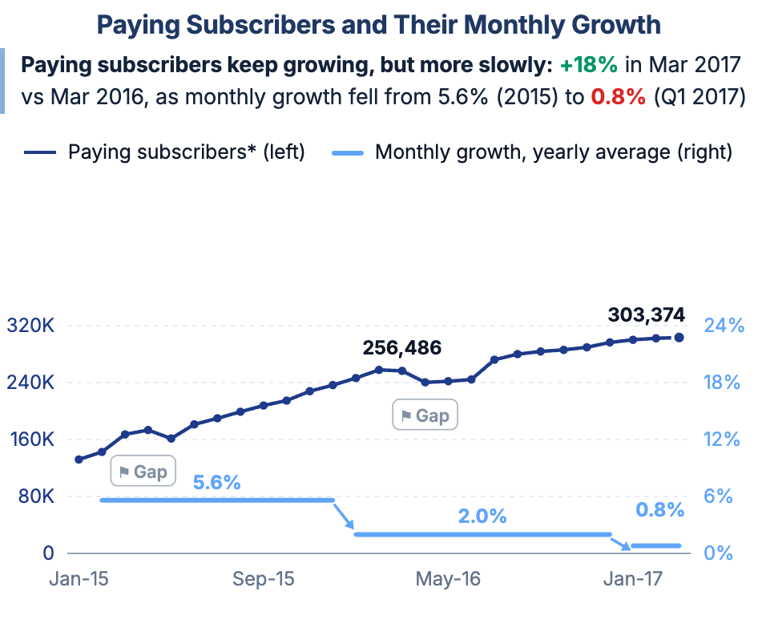

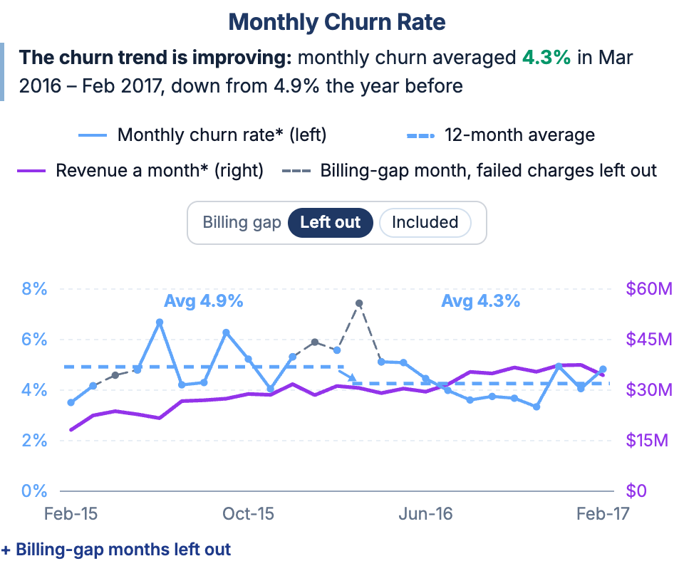

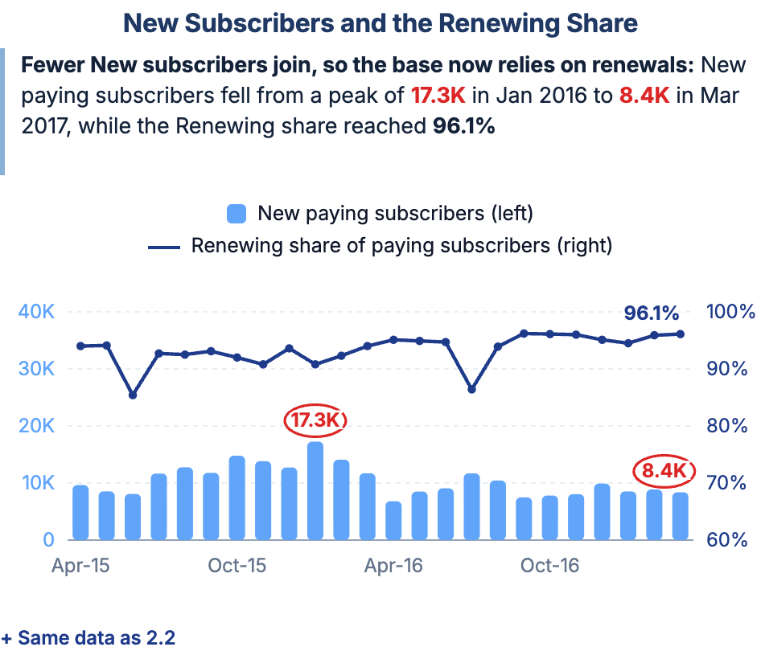

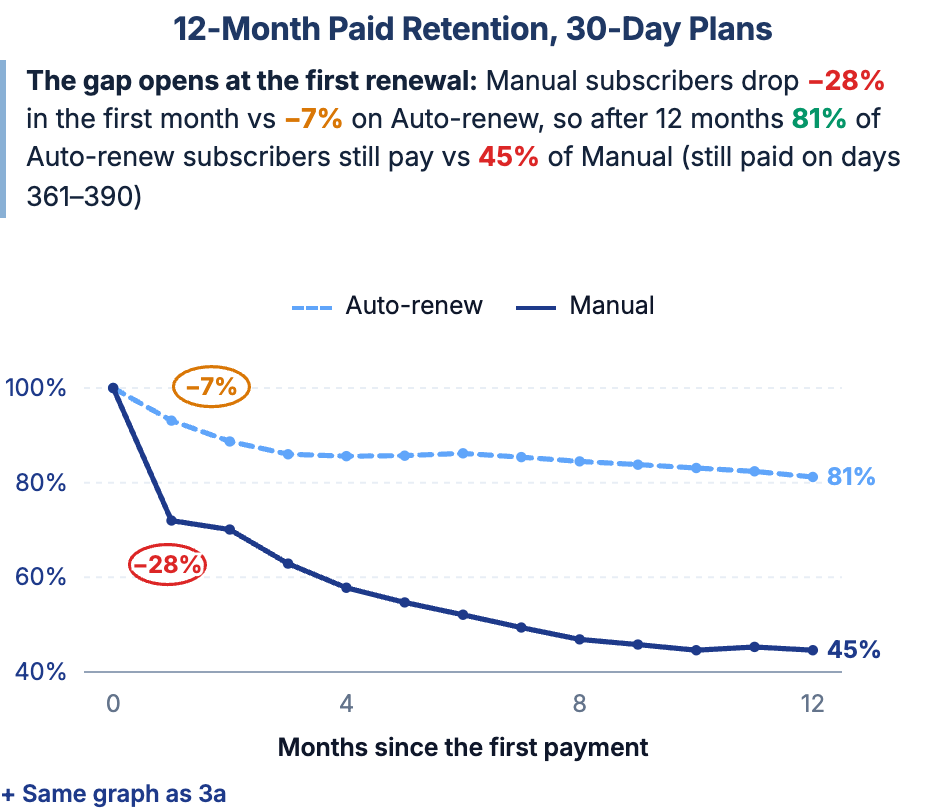

### Q2 · What drives churn?

**The first renewal is the riskiest moment, and payment type is the strongest driver of churn:**
- **Manual subscribers leave far more often:** 19.9% churn per renewal against 3.0% on Auto-renew. Manual is 13% of renewals, but 50% of all churn
- **The first renewal loses the most subscribers:** 17.0% leave at it against 4.5% at later renewals. On 30-day plans, 33.9% of Manual and 9.9% of Auto-renew users leave at the first renewal, against 15%–20% and 2%–4% later
- **Age, city and channel are not drivers on their own:** their effect comes from how their users pay (3a)
- Two cases where payment type is not the whole story: Channel 4 churns about twice as much as Channel 7 on Auto-renew, and City 9's Manual users churn 33% per renewal against 17%–22% in the other large cities

Churn per renewal: renewals due Jul 2015 – Mar 2017, billing-gap renewals left out (`mart_renewal_decisions_3d`).

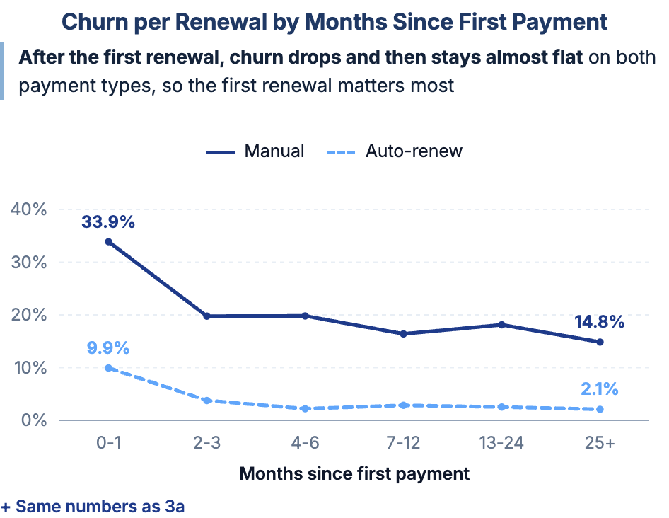

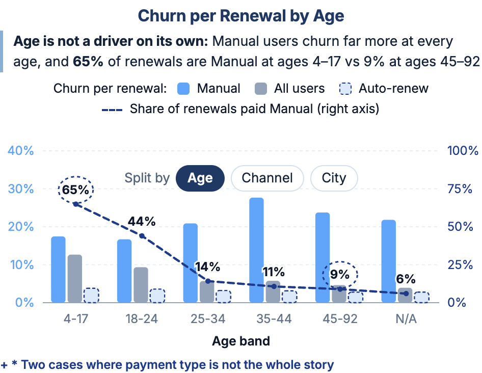

### Q3 · Did the free trials and price points work?

**Free trials added users but not revenue, while $99 subscribers stayed longer and brought similar revenue to those at $149:**
- **Free trials did not lift revenue:** summing their first 3 months of revenue, the 2 free-trial start months (Jun 2015, Nov 2016) brought avg $4.8M vs avg $5.2M for the 2 months before & after without a free trial (−7%, `fct_cohort`). Few trial users ever paid: only 12.9% of the Jun 2015 wave and 4.8% of the Nov 2016 wave (5,420 of 41,854 and 2,312 of 47,866; the Nov 2016 wave had only 4 months to pay)
- **The $99 plan brought the same revenue, as its subscribers churn far less:** Auto-renew users on a 30-day plan who started at $99 in Jul 2015 – Mar 2016 brought $1,160 each by month 12 vs $1,159 at $149, as 92% still paid a year later vs 54% (57,286 at $99, 22,081 at $149, no discount, `fct_subscription`)
- **A 20% discount did not cut revenue per subscriber:** Auto-renew subscribers on a monthly plan at a $149 list price (payment method 41) who bought with a discount in Jan 2015 – Oct 2015 paid $1,700 each over the next 12 months, vs $1,540 at full price (+10%), as they stayed longer. Every start month points the same way ($1,579–$1,744 vs $1,461–$1,607). This is not a random test, so discounted users may differ (2.4)

* None of these was a random test: users who took a trial, the $99 price or a discount may differ in other ways, so these are patterns, not proven causes (4.3)

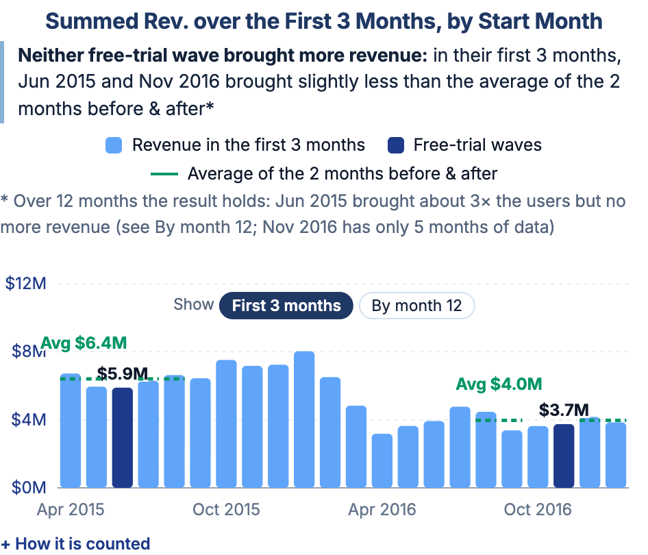

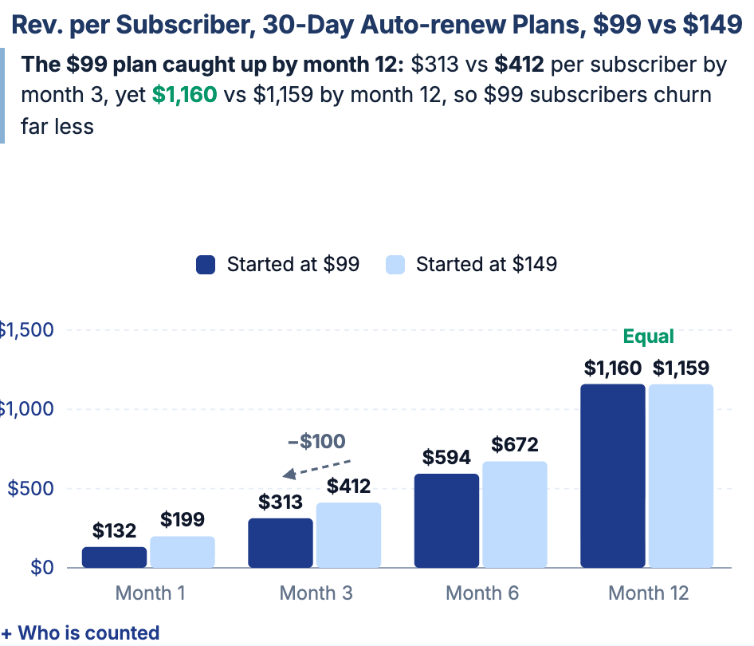

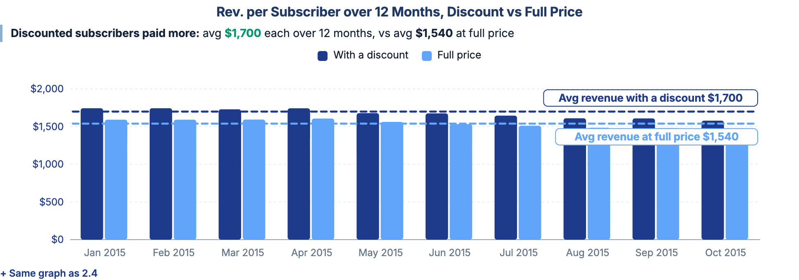

### Q4 · Should we push annual plans harder?

**Annual plans are promising but stopped growing, so it is recommended to test them properly before pushing harder:**
- **Annual plans bring more revenue:** Manual subscribers on an annual plan brought $2,916 each over 18 months against $1,294 on a monthly plan (first paid plan started Jul 2015 – Sep 2015: 3,602 annual, 10,975 monthly). They also bring more than monthly Auto-renew subscribers, who reach $1,733 by month 18. Manual users churn far less a month on annual plans: 2.7% against 18.5% on 30-day plans (`mart_churn_plan_monthly_3d`)
- **Few subscribers choose them:** about 25,000 subscribers have been on an annual plan every month since Apr 2016, so their share of paying subscribers fell from 11.1% to 8.8%
- **The cause is not proven:** the most committed users may be the ones who choose annual plans; the test in 5a (`reports/06_ab_test.md`) will show whether the offer makes people stay

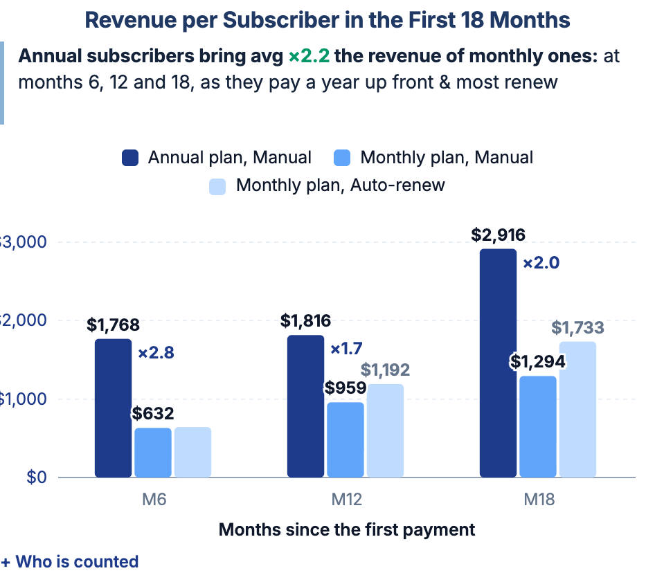

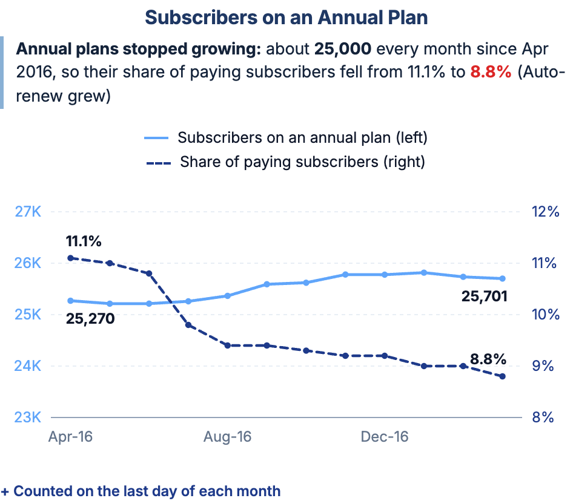

## 4.2 · Three Recommendations: three moves could keep about 10,000 paying subscribers a year

**It is recommended to make three moves, which together could keep about 10,000 more paying subscribers a year:** about 3% of the 303,374 paying subscribers in Mar 2017

Each estimate rests on one assumption, so the low and high scenarios range from 4,500 to 18,500 paying subscribers a year

| Recommendation | Paying subscribers kept a year | Confidence | What would change my mind |
|:--|:--|:--|:--|
| **1 · Move Manual users to Auto-renew** What to do: turn Auto-renew on by default at checkout and at each Manual renewal Why: across all renewals, Manual subscribers churn 19.9% vs 3.0% for Auto-renew subscribers | **~3,200** if 10% of Manual subscribers switch and then churn 10.0% per renewal (range 1,600 – 6,400) | **Medium–High:** payment type is the strongest churn driver, but subscribers who switch may be less committed | A test of Auto-renew on by default shows no drop in churn per renewal |
| **2 · Win the first renewal** What to do: onboard new subscribers and remind them before their first charge Why: across all plans, 17.0% of subscribers churn at their first renewal vs 4.5% at later renewals | **~5,200** if churn at the first renewal falls by a quarter, from 17.0% to 12.8% (range 2,100 – 10,500) | **Medium:** churn clearly peaks at the first renewal, but without app usage data its cause is unknown | Most subscribers who churn at the first renewal came from free trials and never meant to stay |
| **3 · Catch failed payments early** What to do: check failed charges daily for each payment provider, retry them and ask the subscriber for a new card Why: since Nov 2016, subscribers who pay with payment method 40 churn 3.4% per renewal vs 2.7% on payment method 41 | **~1,600** if churn on payment method 40 falls to the 2.7% of method 41 (range 800 – 1,600) | **Low:** method 40's charges stopped failing after 2016, so its churn gap with method 41 is small | Billing logs show that method 40 subscribers cancel on purpose, not because a charge failed |

Range: the low and high scenarios halve or double the assumption of each move (for move 3 the high stays at ~1,600, as churn cannot fall below method 41's 2.7%). How each number was built: the fold "How the ~10,000 subscribers a year was reached" on 4.1. Kept a year = renewals due Jul 2015 – Feb 2017 (failed payments: Nov 2016 – Mar 2017), billing-gap renewals left out, scaled to 12 months.

## 4.3 · What I Can't Answer Yet: why subscribers leave, and whether trials and annual plans cause their results

**Q1, on the health of the subscriber base, is answered except why New subscribers are falling:** Q2 shows who churns but not why, and Q3 and Q4 show results but not their cause, as no free trial, price or plan was tested at random

| Question | What I can't answer yet | What it would take |
|:--|:--|:--|
| Q1 · Health of the base | Why New subscribers have fallen since Jan 2016: less marketing, weaker channels or a smaller market | Marketing spend and campaign data by acquisition channel, compared with New subscribers per channel |
| Q2 · Churn drivers | Why subscribers churn: because they lost interest, or because their card failed | App usage data, and the reason billing records for each failed charge |
| Q3 · Free trials and prices | Whether free trials, the $99 price and the 20% discount cause their results, or only attract subscribers who would have paid anyway | The free-trial and price analysis (brief 3b), and a control group that gets no free trial in the next campaign |
| Q4 · Annual plans | Whether annual plans make subscribers stay, or only attract subscribers who would stay anyway | The annual-plan test in 5a, followed for 12 months |
| All four | Churn in Mar 2017, and the age, city and channel of the 109,330 users missing from `users.csv`, who bring 8.3% of revenue | Apr 2017 transactions and a full `users.csv` export |

Sources: `mart_metrics_month`, `mart_renewal_decisions_3d`, `mart_churn_plan_monthly_3d`, `fct_cohort`, `fct_subscription`, `fct_user_month`.
